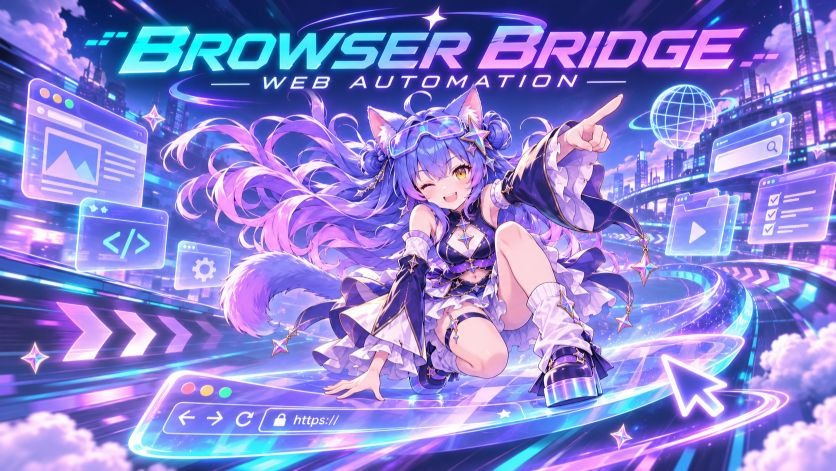

# 🌌 antigravity插件

<p align="center">
  <a href="README.md"><b>简体中文</b></a> | <a href="README_EN.md"><b>English</b></a>
</p>

[](LICENSE)
[](https://antigravity.google)
[]()

> 💡 **声明**：本文由 Gemini 3.8 Flash 生成，插件由 DeepSeek V4.1 Flash 制作。

专为 **Google Antigravity** 量身打造的四大增强插件全家桶：**视觉美化与交互强化**、**浏览器深度接管**、**Win32 桌面控制** 与 **永久分层记忆**。

四大插件均配备专属 3D 看板娘图标，开箱即用，全面赋能个人开发者与自主 AI Agent 协作。

---

## 🎨 插件封面一览 (Showcase Covers)

| [星夜美化 · Custom Wallpaper](./plugins/custom-wallpaper) | [浏览器控制 · Browser Bridge](./plugins/browser-bridge) |
| :---: | :---: |
| [](./plugins/custom-wallpaper) | [](./plugins/browser-bridge) |
| **[电脑控制 · Computer Use](./plugins/computer-use)** | **[长期记忆 · Mnemon](./plugins/mnemon)** |
| [](./plugins/computer-use) | [](./plugins/mnemon) |

---

## 📦 功能介绍

| 插件 | 看板娘图标 | 功能说明 | 核心技术 | 开源协议 |
| :--- | :---: | :--- | :--- | :---: |
| **[星夜美化](./plugins/custom-wallpaper)**<br>`custom-wallpaper` |  | **全景视觉与工作台交互深度强化**<br>• **视觉与插件卡片美化**：一键注入任意高清壁纸与半透明磨砂毛玻璃效果；插件与技能界面卡片样式全新重构美化，并增加一键打开本地文件夹路径的功能。<br>• **对话框全能强化**：输入框支持插件快捷调用选项、常用提示词预设快捷选择、思考强度（Thinking Budget）滑块调节选项。<br>• **对话栏与右侧会话极速跳转**：右侧对话列表支持快速点击秒级跳转对话、对话进度条强化、支持一键下载导出完整对话、支持标记独立未读对话。<br>• **文件交互与开发辅助**：对话中的文件支持右键直接打开文件或直接定位所在文件夹路径。<br>• **系统级遥测与汉化**：底部常驻 Token 额度监控、上下文窗口遥测小窗与未读对话雷达；760+ 词条无损一秒中英双向瞬切汉化引擎。 | CSS Variables / DOM Observer / Canvas / Python 测试套件 | [MIT](plugins/custom-wallpaper/LICENSE) |
| **[浏览器控制](./plugins/browser-bridge)**<br>`browser-bridge` |  | **日常浏览器深度直连与 RPA 录制回放**<br>• 直连日常使用的已登录 Edge / Chrome，保留原有的全部 Cookie、账号状态与扩展插件。<br>• 赋能 AI 自主执行网页调研、资料搜集、自动点击与复杂表单填写。<br>• **演示即生成 Skill**：在网页上操作一遍，即可自动提取可变参数并沉淀为专属 AI 技能，支持后续一键自动化快放。<br>• 悬浮录制胶囊支持划词备注与元素提取，具备视觉自愈与多窗口防冲突中继。 | MCP 协议 / Chrome MV3 扩展 / CDP 桥接 / 自动化回放 | [MIT](plugins/browser-bridge/LICENSE) |
| **[电脑控制](./plugins/computer-use)**<br>`computer-use` |  | **系统级 Win32 原生桌面接管**<br>• 当目标软件没有提供开放 API 时，让 AI 直接识别屏幕画面、控制鼠标点击与键盘输入。<br>• 完整支持 4K / 带鱼屏 / 多屏超宽组合的高分屏缩放感知 (Per-monitor DPI)。<br>• 屏幕顶部常驻醒目的防误触控制横幅与真实鼠标轨迹，运行状态清晰透明。<br>• 原生 Win32 API 纯净驱动，零笨重外部环境依赖，兼顾极速响应与运行安全。 | Win32 GDI / UI Automation / Windows Native API | [MIT](plugins/computer-use/LICENSE) |
| **[长期记忆](./plugins/mnemon)**<br>`mnemon` |  | **分层记忆金库与永恒人设引擎**<br>• 彻底解决多轮长对话中 AI 遗忘人设、习惯与项目决策的痛点。<br>• 运行时三层记忆体系 (`PERSONA` / `USER` / `MEMORY`)，对话启动前无感命中召回。<br>• 本地主金库与第二驱动器镜像原子双驱同步，配合每日 gzip 压缩快照，具备启动级自愈修复能力。<br>• 数据 100% 留存在本地磁盘，无需上传任何第三方云端，保障绝对数据隐私。 | 分层记忆引擎 / 语义+关键词混合索引 / 本地原子双驱镜像 | [MIT](plugins/mnemon/LICENSE) |

---

## 🚀 极速安装使用

### 方式一：一键全自动安装（推荐）

克隆本仓库并在 PowerShell 中运行安装脚本，将自动把四大插件同步至 Antigravity 插件目录：

```powershell
# 1. 克隆本仓库
git clone https://github.com/mogudesu/antigravity-suite.git
cd antigravity-suite

# 2. 执行安装脚本
.\install.ps1
```

### 方式二：手动选择安装

如果你只需要其中的部分插件，只需将 `plugins/` 目录下的对应文件夹拷贝到 Antigravity 插件目录：

- **Windows 插件默认路径**：`%USERPROFILE%\.gemini\config\plugins\`
- **Linux / macOS 插件默认路径**：`~/.gemini/config/plugins/`

拷贝完成后重启或刷新 Antigravity，插件即刻自动加载！

---

## 🛠️ 一键同步与更新推送 (`sync-push.ps1`)

对于持续维护插件的开发者，仓库内置了自动化同步与发布工具：

在本地日常修改了插件代码、CSS 样式或配置后，无需手动复制代码：

```powershell
# 在本项目根目录下运行：
.\sync-push.ps1 "feat: 升级某项新特性"
```

脚本将自动执行：
1. 从本地插件目录提取最新代码（智能过滤临时日志与无用缓存）；
2. 自动检测 Git 差异与版本状态；
3. 自动暂存、提交并推送到 GitHub 远程仓库！

---

## 🎯 面向自主 AI Agent 的深度优化

本套件不仅供人类开发者使用，同时针对各类编码 Agent（Antigravity、Claude Code、Cursor、Codex 等）进行了针对性语义优化：
- **操作规范完备**：每个插件均内置独立的 `rules/AGENTS.md`，Agent 进入插件目录即可自动吸纳操作规约与最佳实践；
- **标准 MCP 协议支持**：附带完整的 Tool Schema 与 `skills/` 技能定义，Agent 能秒级发现并直接驱动；
- **质量保障门禁**：内置全套自动化测试套件（750+ 项单测全绿验证），杜绝代码回归。

---

## 📄 开源许可协议 (License)

本项目采用国际著名、广泛使用的 **[MIT License](LICENSE)** 开源协议。

MIT 是世界公认最著名的宽松型开源协议之一（与 React、Vue、Node.js 相同），具有极高的自由度与商业友好性：无论个人自用、开源二次开发还是商业闭源集成，均可完全自由使用与分发，仅需在衍生版本中保留原作者版权声明即可。
