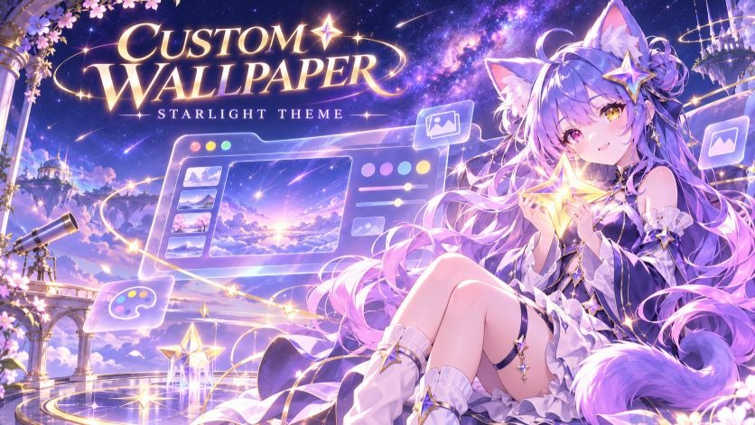
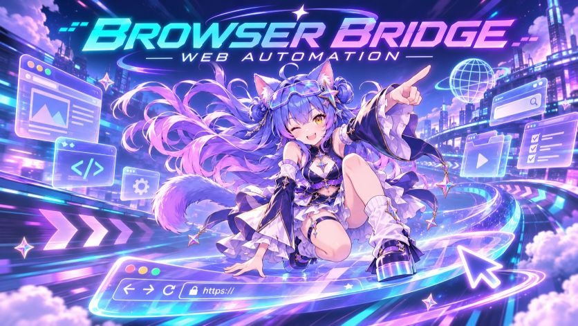
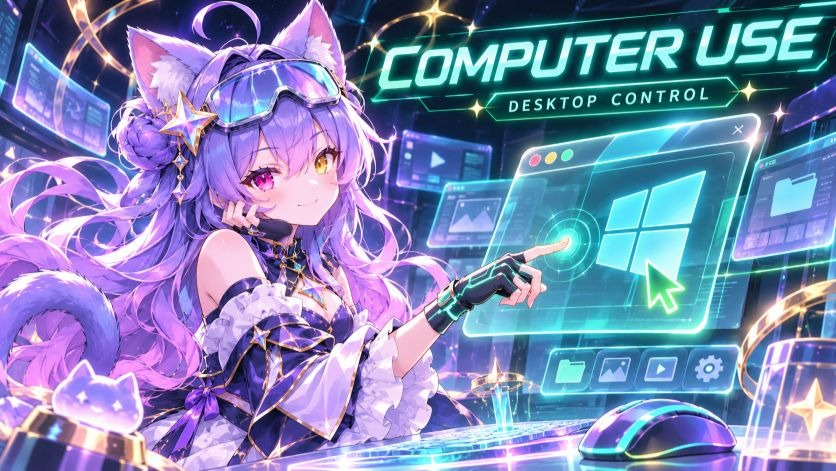
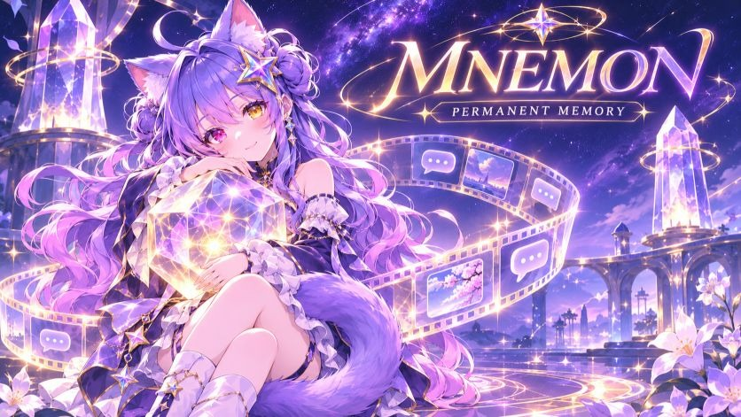
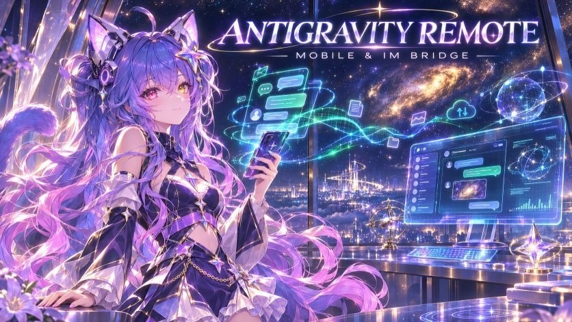
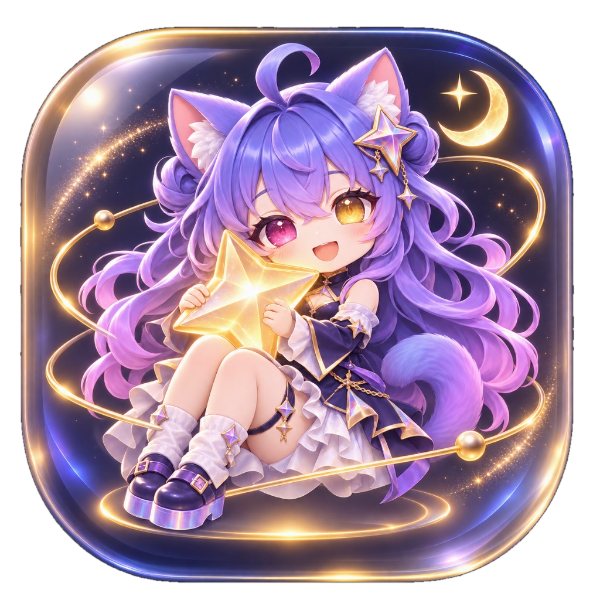
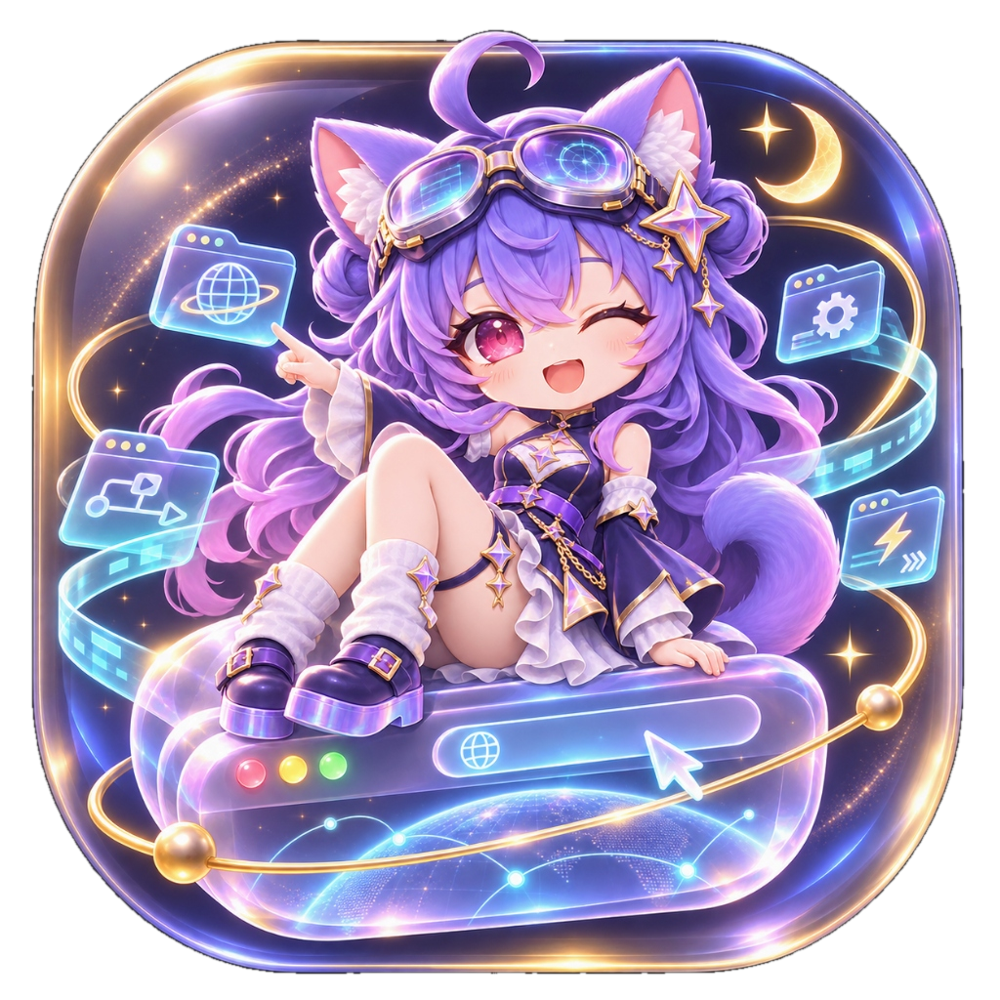
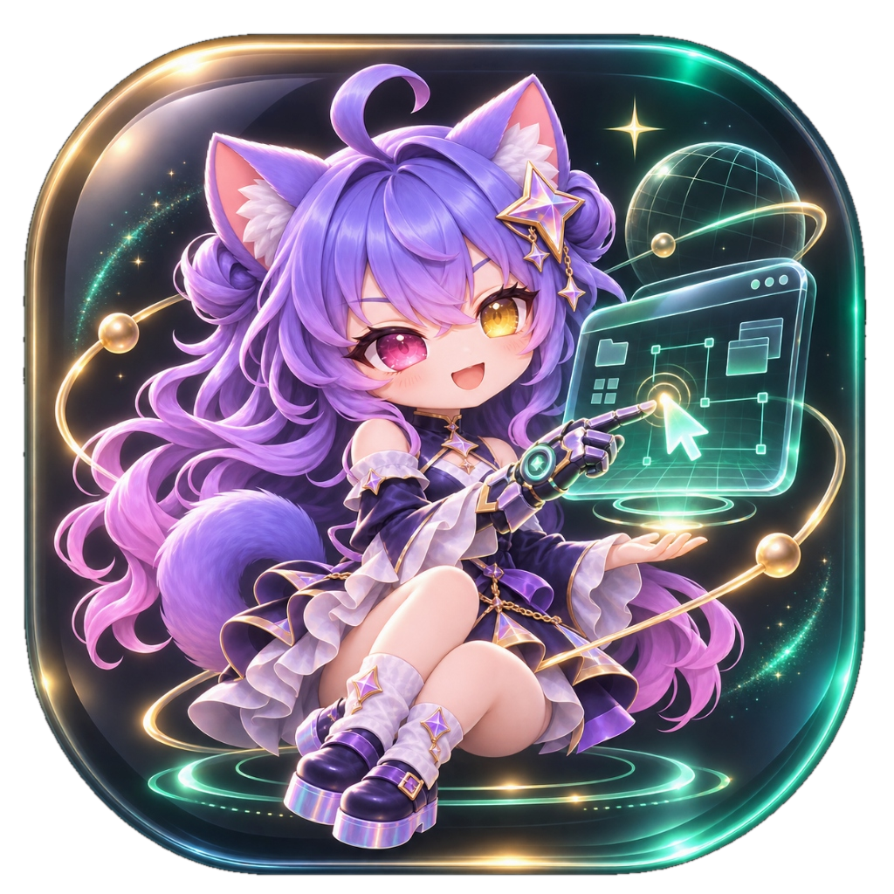
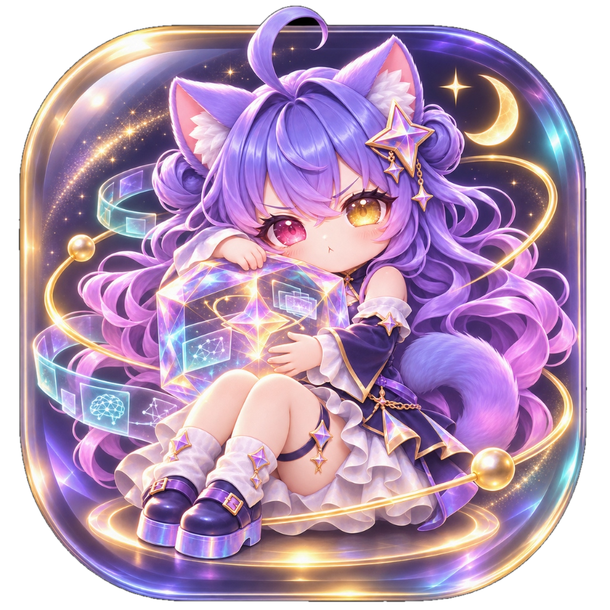

# 🌌 Antigravity Suite Plugins

<p align="center">
  <a href="README.md"><b>简体中文</b></a> | <a href="README_EN.md"><b>English</b></a>
</p>

[](LICENSE)
[](https://antigravity.google)
[]()

> 💡 **Notice**: This document was generated by Gemini 3.8 Flash, and the plugins were crafted by DeepSeek V4.1 Flash.

The flagship suite of 5 core enhancement plugins tailored specifically for **Google Antigravity**: **Visual Beautification & Workspace Interaction**, **Deep Browser Automation**, **Native Win32 Desktop Control**, **Permanent Layered Memory**, and **Cross-Platform Mobile Remote Bridge (WeChat / QQ / Feishu)**.

Each plugin comes equipped with an exclusive 3D mascot avatar icon (transparent PNG), ready out of the box to empower individual developers and autonomous AI Agents.

---

## 🎨 Official Showcase Covers

| [Custom Wallpaper](./plugins/custom-wallpaper) | [Browser Bridge](./plugins/browser-bridge) |
| :---: | :---: |
| [](./plugins/custom-wallpaper) | [](./plugins/browser-bridge) |
| **[Computer Use](./plugins/computer-use)** | **[Mnemon](./plugins/mnemon)** |
| [](./plugins/computer-use) | [](./plugins/mnemon) |

<p align="center">
  <a href="./plugins/remote"><b>Antigravity Remote (WeChat / QQ / Feishu Bridge)</b></a><br>
  <a href="./plugins/remote"></a>
</p>

---

## 📦 Features & Capabilities

| Plugin | Mascot Icon | Feature Description | Core Tech Stack | License |
| :--- | :---: | :--- | :--- | :--- | :---: |
| **[Custom Wallpaper](./plugins/custom-wallpaper)**<br>`custom-wallpaper` |  | **Workspace Visuals & Deep Interaction Overhaul**<br>• **Visuals & Plugin Card Styling**: One-click injection of HD wallpapers with frosted-glass acrylic effects; revamped layout for Plugin & Skill cards with a one-click button to open local directory paths.<br>• **Composer Box Enhancements**: Built-in plugin invocation switch, prompt preset quick-selection dropdown, and thinking budget slider.<br>• **Chat Bar & Right-Sidebar Navigation**: Click to jump directly to active/historical conversations in the right-sidebar; enhanced progress bars; export/download full conversation logs; mark independent chats as unread.<br>• **File Action Menus**: Right-click any file mention in chat to open the file directly or reveal it in File Explorer.<br>• **System Telemetry & i18n**: Real-time token counters, context window monitors, unread conversation radar, and a 760+ term lossless instantaneous bilingual Chinese translation engine. | CSS Variables / DOM Observer / Canvas / Python Test Suite | [MIT](plugins/custom-wallpaper/LICENSE) |
| **[Browser Bridge](./plugins/browser-bridge)**<br>`browser-bridge` |  | **Everyday Browser Direct Connect & RPA Record-Replay**<br>• Directly interfaces with your logged-in Microsoft Edge or Google Chrome, retaining all existing cookies, session states, and browser extensions.<br>• Enables AI to autonomously conduct web research, gather intelligence, click UI elements, and fill complex forms.<br>• **Demonstration-to-Skill**: Perform an action on the webpage once; the system extracts variable parameters and compiles them into a reusable AI skill for deterministic fast replay.<br>• Floating recording pill with text annotations and DOM picking, accompanied by visual self-healing and multi-window conflict-free relay. | MCP Protocol / Chrome MV3 Extension / CDP Bridge / RPA Replay | [MIT](plugins/browser-bridge/LICENSE) |
| **[Computer Use](./plugins/computer-use)**<br>`computer-use` |  | **System-Level Native Win32 Desktop Control**<br>• When target desktop applications lack public APIs, allows AI to perceive screens, manipulate the mouse, and synthesize keystrokes.<br>• Full support for 4K, ultrawide, and multi-monitor setups with per-monitor DPI scaling awareness.<br>• Persistent topmost warning banner and animated mouse cursor trails to guarantee complete visibility and safety.<br>• Pure native Win32 API drivers without heavy Python dependencies, ensuring instant response and high reliability. | Win32 GDI / UI Automation / Windows Native API | [MIT](plugins/computer-use/LICENSE) |
| **[Mnemon](./plugins/mnemon)**<br>`mnemon` |  | **Layered Memory Vault & Permanent Persona Engine**<br>• Eliminates AI amnesia across long multi-turn sessions regarding user preferences, persona traits, and core project decisions.<br>• Runtime three-tier memory architecture (`PERSONA` / `USER` / `MEMORY`), automatically retrieved before each conversation turn.<br>• Atomic dual-drive mirroring between the local vault and secondary backup drive, complemented by daily gzip snapshots for self-healing recovery.<br>• 100% stored on local disk without cloud uploads, preserving total data sovereignty and privacy. | Layered Memory Engine / Hybrid Semantic + Keyword Indexing / Local Atomic Dual-Drive Mirroring | [MIT](plugins/mnemon/LICENSE) |
| **[Antigravity Remote](./plugins/remote)**<br>`antigravity-remote-mogu` |  | **Cross-Platform WeChat / QQ / Feishu Remote Bridge**<br>• **Multi-Channel Bot Binding**: Scan QR codes directly in the control panel to pair WeChat, QQ, or Feishu bots. Send messages from your smartphone to drive Antigravity sessions on your workstation.<br>• **Live Bi-Directional Streaming & File Pushback**: Thinking loops, tool call progress, and final answers are streamed live to your mobile chat. Generated reports, code packages, images, and documents are automatically pushed back into the chat as attachments.<br>• **Two-Tier Architecture & Background Dispatch**: Combines SQLite conversation index with JSONL transcript stream, mediated by a CDP UI driver with a global mutex lock. Keep coding in the background without UI interruption.<br>• **Concurrency & Collision Safety**: Strict @bot trigger in group chats, queuing and steering support in DMs, allowing flawless remote management from anywhere. | Remote Hub / iLink WeChat / OneBot / Feishu WSClient / CDP Dispatcher | [MIT](plugins/remote/LICENSE) |

---

## 🚀 Quick Installation

### Method 1: Automatic One-Click Install (Recommended)

Clone the repository and run the PowerShell installer to automatically link and copy the suite into your Antigravity plugins directory:

```powershell
# 1. Clone repository
git clone https://github.com/mogudesu/antigravity-suite.git
cd antigravity-suite

# 2. Run installer
.\install.ps1
```

### Method 2: Manual Installation

If you only need specific plugins, simply copy the corresponding folder under `plugins/` directly to your Antigravity plugin directory:

- **Windows Path**: `%USERPROFILE%\.gemini\config\plugins\`
- **Linux / macOS Path**: `~/.gemini/config/plugins/`

Restart or reload Antigravity, and the plugins will load immediately!

---

## 🛠️ Instant Maintenance & Sync (`sync-push.ps1`)

For developers maintaining and iterating on these plugins:

When you modify styles, scripts, or rules inside your local Antigravity runtime, push updates to GitHub effortlessly:

```powershell
# Run from the repository root:
.\sync-push.ps1 "feat: upgrade a new capability"
```

The script automatically:
1. Pulls the latest code from `~/.gemini/config/plugins/` while filtering out runtime logs and temporary caches;
2. Checks git diff status;
3. Stages, commits, and pushes to your remote GitHub repository!

---

## 🎯 Built for Autonomous AI Agents

This suite is optimized not only for human engineers, but also for autonomous coding agents (Antigravity, Claude Code, Cursor, Codex, etc.):
- **Agent Rules**: Every plugin contains an independent `rules/AGENTS.md` so agents understand constraints and best practices upon entering the directory;
- **Native MCP Support**: Complete tool schemas and `skills/` declarations enable zero-prompt discovery and execution;
- **Quality Gates**: Includes a full suite of automated unit tests (750+ checks passing) to prevent regressions.

---

## 📄 License

This project is licensed under the world-renowned and business-friendly **[MIT License](LICENSE)**.

MIT is one of the most widely adopted open-source licenses globally (used by React, Vue, Node.js, and more). You are completely free to use, modify, distribute, and integrate this software for both personal and commercial purposes, provided the original copyright notice is retained.
